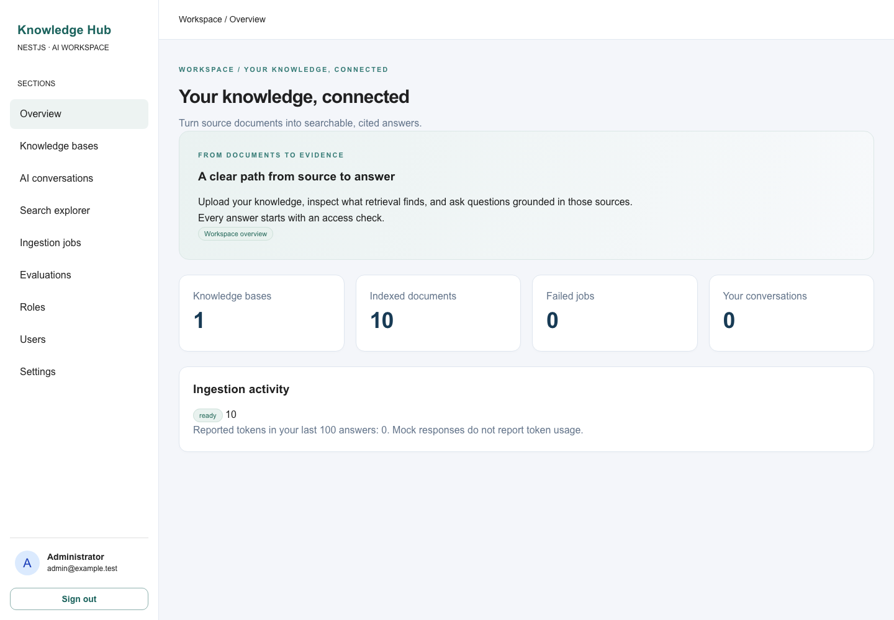

# NestJS AI Knowledge Hub

A document knowledge workspace built on the NestJS CMS ecosystem. Upload sources, inspect hybrid retrieval, ask streamed questions with source references, and measure retrieval against a reproducible evaluation dataset.

This is more than a chat interface: it includes persistent ingestion jobs, PostgreSQL vectors and full-text search, ownership checks, reindexing, source downloads, chat history, and calculated evaluation metrics. It is an initial implementation with explicit limitations, not a production certification.



## Quick start

Requires Node 22.3+ (Node 22 LTS recommended), pnpm 10.28.2 and Docker Compose.

```bash
cp .env.example .env
corepack enable
pnpm install --frozen-lockfile
docker compose up -d --wait postgres redis
pnpm db:migrate
pnpm dev
```

In a second terminal, after the API starts:

```bash
pnpm db:seed
node scripts/wait-demo.mjs
pnpm eval
```

Open http://localhost:3000. Local demo login: `admin@example.test` / `local-demo-password-change-me`, from `.env.example`. Replace these before sharing an environment. Bootstrap only creates an administrator when the CMS users table is empty. Manage additional users and roles in the built-in CMS administration sections.

Seeding deliberately uses authenticated HTTP uploads: **start the API and worker before `db:seed`**. This is the precise alternative to seeding before `pnpm dev`. Running the seed again skips existing demo filenames. It does not overwrite edited documents.

The default `.env.example` explicitly selects `AI_PROVIDER=mock`. This produces labelled extracts and deterministic hashed embeddings to exercise the application without paid credentials. It is not genuine LLM generation and is never used as a failure fallback.

## Web application structure

`apps/web` uses `@nestjs-cms/admin@0.1.4` and follows its recommended sections layout:

- `src/admin.config.ts` composes the theme, permissions, and explicitly registered sections in navigation order within the client boundary.
- `src/sections/*.ts` each default-export a `defineCustomSection(...)` definition.
- `src/components/` contains the section React views and shared UI components.
- `src/hooks/` and `src/lib/` contain shared data hooks, API helpers, and types.
- `src/app/` contains the Next.js routes, layout, styles, and same-origin API proxy.

Add new section definitions under `src/sections/` and register them in `src/admin.config.ts`. Users and roles use `createAuthSections(permissions)`; if extra auth fields are needed, add `src/sections/auth-extensions.ts` and pass its configuration as the second argument, with matching backend fields.

## Full Docker workflow

```bash
cp .env.example .env
docker compose -p hub-docker up --build -d
docker compose -p hub-docker exec api node dist/scripts/seed.js
docker compose -p hub-docker exec api node scripts/wait-demo.mjs
docker compose -p hub-docker exec api node dist/scripts/evaluate.js
```

This path uses the separate `hub-docker` Compose project so its database and uploaded-file volume stay together. Stop the native development stack before switching workflows; do not point a database populated by native file storage at an empty Docker file volume.

The migration service runs first. PostgreSQL, Redis and uploaded files have persistent volumes. The API and worker run as a non-root user. Ports bind to loopback. This Compose setup is for local development (`NODE_ENV=development` enables HTTP session cookies); production requires HTTPS, an HTTPS `ADMIN_ORIGIN`, and production configuration. See [security](docs/security.md).

Do not run native and Docker APIs simultaneously on ports 3000/3001. `docker compose stop` preserves data. Removing volumes deletes data and is never part of normal startup.

## What is implemented

- CMS session authentication and user/role management; private and shared knowledge bases.
- TXT/Markdown, text-based PDF and DOCX upload, hashing, duplicate detection, local storage and asynchronous extraction.
- BullMQ retries and database job outbox, bounded overlapping chunks, configurable embeddings and atomic index replacement.
- PostgreSQL cosine search, full-text search and configurable weighted Reciprocal Rank Fusion (RRF).
- Authenticated fetch/SSE chat, cancellation, source cards/downloads and persistent history.
- Next.js dashboard, knowledge/document management, search explorer, jobs, evaluation history and read-only configuration.
- Twenty evaluation questions over ten fictional Northstar Supply documents; Recall@K, MRR, latency, provider usage and configured cost estimates.
- OpenAI-compatible and Ollama HTTP adapters; an explicitly selected deterministic test provider.
- Unit, real PostgreSQL/Redis API integration, and Playwright browser tests; Docker and CI configuration.

## How retrieval and ingestion work

Semantic similarity helps with wording differences; PostgreSQL full-text search helps exact terms. RRF combines ranked candidate lists without pretending their raw scores share a scale. The explorer labels cosine similarity, text rank and RRF separately.

Access is checked before embedding/retrieval, and SQL candidate selection includes the knowledge-base policy. Only retrieved database records become source cards. Document text is untrusted evidence in the model prompt, never authorization input. Chat sessions are private to their creator, including against other administrators.

Uploads create persistent document and ingestion-job rows. The worker dispatches those rows to BullMQ, extracts text, batches embeddings and commits replacement chunks in one transaction. Only `ready` documents appear in retrieval. Reindexing temporarily hides the document, then swaps its index; failures remain visible in job status and can be reindexed manually. Deletion cascades chunks and jobs and removes the stored file. See the deliberately conservative chat/evaluation [retention policy](docs/security.md).

## Configure real AI

For a **new empty database**, configure a provider before migration and seeding:

```dotenv
AI_PROVIDER=openai
AI_BASE_URL=https://api.openai.com/v1
AI_API_KEY=your-server-side-key
CHAT_MODEL=gpt-4o-mini
EMBEDDING_MODEL=text-embedding-3-small
EMBEDDING_DIMENSIONS=1536
```

For Ollama use `AI_PROVIDER=ollama`, `AI_BASE_URL=http://localhost:11434`, a downloaded chat model and embedding model, and that embedding model's actual output dimensions (for example `nomic-embed-text` uses 768). The optional Compose profile starts Ollama; pull models explicitly with `docker compose exec ollama ollama pull <model>`. From the API/worker containers use `http://ollama:11434`. Changing models in an existing database requires the documented [model migration](docs/development.md#embedding-model-changes). Dimensions and model fingerprints are validated; no silent truncation or padding occurs.

## Verification

```bash
pnpm typecheck
pnpm lint
pnpm test
pnpm build
# API, worker, PostgreSQL and Redis must be running:
pnpm test:integration
# Built or development frontend must also be running:
pnpm exec playwright install chromium
pnpm test:e2e
pnpm eval
```

The optional real-provider smoke runs with `REAL_PROVIDER_SMOKE=1 pnpm test` and your provider variables exported. Mock tests verify orchestration and access control, not model answer quality. Actual executed results are in [the implementation report](docs/implementation-report.md).

## Documentation

- [CMS package investigation and compatibility](docs/cms-integration-analysis.md)
- [Automatically discovered API resources](docs/resources.md)
- [Architecture and database boundaries](docs/architecture.md)
- [API contract](docs/api.md) · live OpenAPI: http://localhost:3001/api/docs
- [Configuration reference](docs/environment.md)
- [Development, operations and model changes](docs/development.md)
- [Security and retention](docs/security.md)
- [Evaluation methodology](docs/evaluation.md)
- [Roadmap and limitations](docs/roadmap.md)
- [Contributing](CONTRIBUTING.md)

## Limitations and licensing

No OCR, agent execution, MCP server, tenants, cloud storage, reranker, incremental CMS content sync, or model-judged answer quality is claimed. Token budgets use a character estimate, not model-specific tokenization. Historical turns are displayed but not sent to generation; every question uses fresh evidence. Evaluations run within an HTTP request and are not yet a durable background workflow. Parsing untrusted complex files needs further resource isolation for public deployments.

`@nestjs-cms/admin@0.1.4` is published as `UNLICENSED`, and the other investigated CMS metadata omit license grants. An MIT license for the assembled project is therefore deferred pending the author's licensing clarification. No upstream packages have been modified or republished. See [integration analysis](docs/cms-integration-analysis.md).
