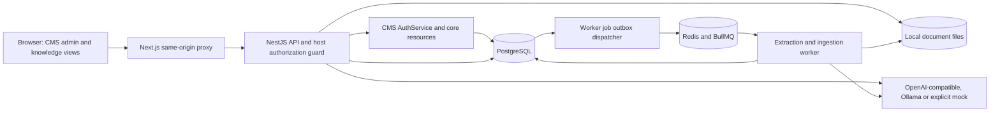
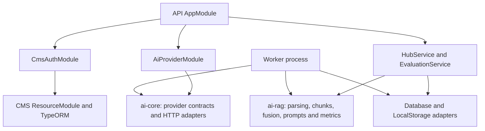
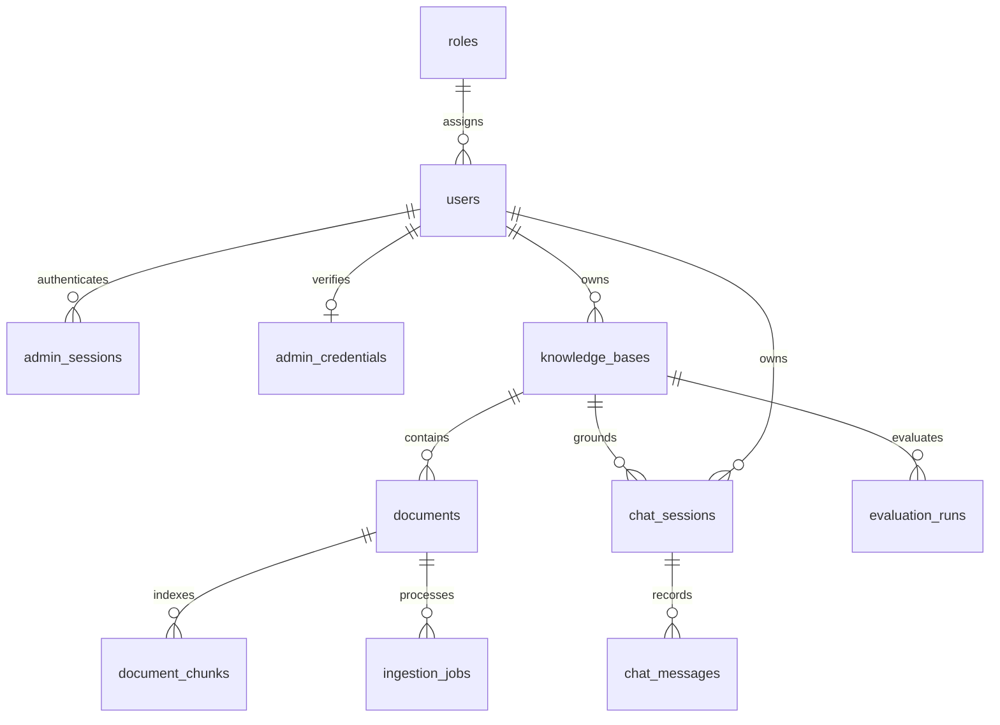

# Architecture

A modular NestJS monolith and a separate ingestion worker share PostgreSQL and local file storage. The Next.js server proxies same-origin `/api` traffic, preserving the CMS session cookie and mutation header. No provider credential enters the browser.

## Module dependencies

`packages/ai-core` and `packages/ai-rag` are framework independent. `packages/cms-ai` exports CMS options, pure access policies and the reusable `AiProviderModule.forRoot(options)` / `AI_PROVIDER` Nest binding. They are private workspace packages, not yet separately publishable npm artifacts. The API's domain services remain host-specific.

## Database schema

The reviewed SQL in `apps/api/migrations` is authoritative. The CMS migration was generated from the actual auth/core entity definitions. A migration ledger and advisory transaction lock serialize migration application. TypeORM schema synchronization is disabled.

Vectors use `vector` storage plus a dimension-specific expression HNSW index. `ai_settings` pins the model fingerprint/dimension for the database. Full-text search uses a stored English `tsvector` with a GIN index. Permissions are predicates on candidate queries, not a post-generation filter. RRF is performed on independently authorized candidate lists.

File writes precede the document/job transaction; a failed transaction removes the file. The worker periodically publishes queued/processing database job IDs to BullMQ using stable queue IDs. Redis persistence is enabled. Embeddings are computed outside a transaction; publication locks the document, checks version, deletes old chunks and inserts the complete new set atomically. A concurrent delete prevents publication. Failed jobs are retained and can be reindexed with a new job ID.

The source tree uses explicit SQL at vector repository boundaries. Table names/SQL structure are static; user values are bound. The sole interpolated vector dimension originates in validated integer configuration, never user or model input.
